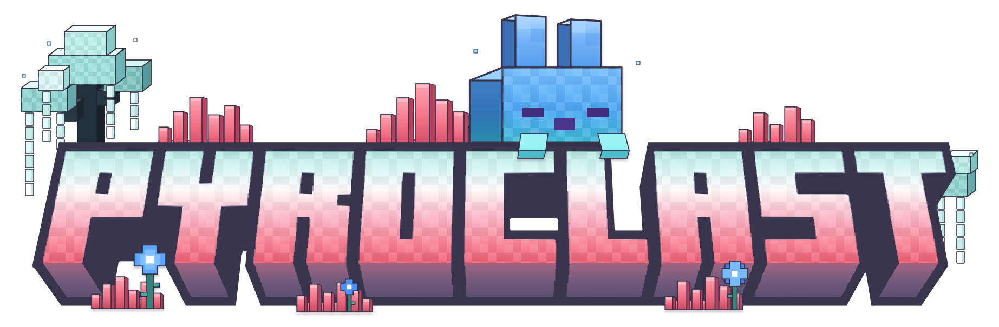

<p align="center">
  
</p>

- <a href="docs/optimizations.md"></a>&nbsp;&nbsp;[Engine Optimizations](docs/optimizations.md) — Vulkan layout tracking, scoped sync2 barriers, 4×4×4 region MDI, 20B/28B/40B vertices, async occlusion, and entity/UI fast paths
- <a href="docs/shader-bridge.md"></a>&nbsp;&nbsp;[Shader Bridge SPI](docs/shader-bridge.md) — `TurboShadersBridge` contract, pass ordering invariants, 40B vertex layout, and zero-copy slice callbacks
- <a href="docs/configuration.md"></a>&nbsp;&nbsp;[Configuration & Diagnostics](docs/configuration.md) — `vulkanturbo.json` options, vendor auto-tuning, `FrameProfiler`, diagnostic logs, and JVM/Gradle flags
- <a href="AGENTS.md"></a>&nbsp;&nbsp;[Contributor & Agent Rules](AGENTS.md) — clean-room policy, architectural invariants, and verification checks

> **Version:** `0.1.0-alpha.1` (Fabric). Targets **Minecraft: Java Edition 26.3** (`~26.3`) on Mojang's native **RenderPearl** Vulkan backend.

**Pyroclast** (`vulkanturbo` / `TEPHRA`) is a clean-room Vulkan rendering performance mod written in Kotlin and Java against Mojang's RenderPearl API and the Vulkan specification. On non-Vulkan RenderPearl backends, all hooks disable themselves automatically and emit a chat notice.

## Requirements & Installation

1. Install **Fabric Loader `0.20.1+`** for **Minecraft `26.3`** on **Java 25**.
2. Place `vulkanturbo-0.1.0-alpha.1.jar` into `<gameDir>/mods/`. `fabric-language-kotlin` (`1.14.2+kotlin.2.4.21`), `fabric-resource-loader-v1`, and `fabric-api-base` are bundled via Jar-in-Jar.
3. Optional companion: **Hyaloclast** (`vulkanshaders`) layers on top via `TurboShadersBridge` (`mixinPriority = 900` in Pyroclast, `1100` in Hyaloclast).

## Building & Testing

Requires **JDK 25** (Gradle `9.8.1`, Fabric Loom `1.19.4`, Kotlin `2.4.21`). Output JARs are written to `build/libs/`.

```sh
./gradlew test
./gradlew build
```

Development client run flags (`build.gradle.kts`):

```sh
./gradlew runClient -Pvt.quickWorld=<saveName>
./gradlew runClient -Pvt.jfr=profile.jfr
```

## Subsystems

| Subsystem | Packages | Key Optimizations |
| :--- | :--- | :--- |
| **Vulkan** | `core/vulkan`, `mixin/vulkan` | State deduplication, scoped `VK_KHR_synchronization2` barriers, per-texture layout tracking, deferred dynamic rendering, disk-backed `VkPipelineCache`, 4096-entry `VkBufferView` LRU cache, persistent VMA mapping & BDA promotion |
| **Chunk** | `core/chunk`, `mixin/chunk` | 4×4×4 region `vkCmdDrawMultiIndexedEXT` / indirect ring, 7-bucket directional face culling, 20B compact terrain vertices, `RegionBatchPlan` multi-frame reuse, async occlusion culling, flat lighting/occlusion/VisGraph/VoxelShape caches |
| **Vertex** | `core/vertex`, `mixin/vertex` | Packed 24-bit `NormalCache`, single-reservation off-heap quad builders, mapped dynamic uniform/indirect ring buffers, native translucency centroid sorting, `UberGpuBuffer` heap reclamation & 280B alignment |
| **Entity & UI** | `core/entity`, `mixin/entity` | Direct off-heap entity/particle/weather/glyph/blit/rect builders, render-thread `PoseStack.Pose` pool (up to 16,384 poses), flat `ModelPart`/`Cube` arrays |
| **Profiler & Diagnostics** | `core/profiler`, `diagnostics`, `gui` | 4-slot rotating GPU timestamp `GpuQueryPool`, CPU phase timers, `VulkanDiagnosticLog`, crash report section, in-game settings & `F9` error log viewer |
| **Shader Bridge** | `api/shader` | `TurboShadersBridge` SPI with `@JvmField` fast-path guard, 40B extended vertex format, 4-MRT attachment overrides, custom descriptor sets, zero-copy `UberGpuBuffer` slice callbacks |

## Benchmarking

Run isolated alternating A/B benchmarks via `bench/compare.py` (uses a minimal JDK 25 `-javaagent` hooked into `GameRenderer.renderLevel()`):

```sh
python3 bench/compare.py --help
```

## License

Licensed under **Apache-2.0** ([`LICENSE`](LICENSE)). All code is clean-room; see [`AGENTS.md`](AGENTS.md) for provenance and contribution rules.
